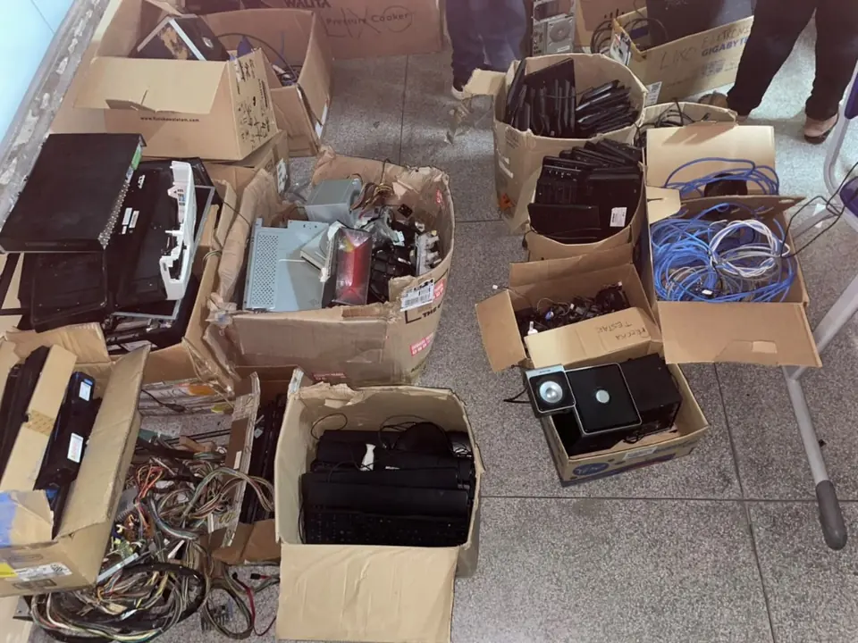

# T.I Verde — Tecnologia, Inovação e Sustentabilidade (EETEPA Vilhena Alves)

Site mobile-first dedicado à produção do **Curso Técnico em Informática (2º período subsequente 2026)** da **EETEPA Vilhena Alves** (SECTET / Governo do Pará) para o **Circuito Integrador 2026** (**26/11/2026, início às 19h30, Auditório da Escola Vilhena Alves, entrada gratuita**).

🔗 **Página publicada (GitHub Pages):** [albertomateus9.github.io/TI_Verde](https://albertomateus9.github.io/TI_Verde/)  
🔗 **Portal completo dos 5 cursos:** [albertomateus9.github.io/Projetos_Subsequente_2026](https://albertomateus9.github.io/Projetos_Subsequente_2026/)

<p align="center">
  
</p>

---

## O que foi produzido pela turma

1. **Oficina real na EETEPA em 4 etapas** — Fotografias reais autorizadas pelos estudantes (trilho horizontal no celular e grade 2×2 no desktop, com ampliação sob demanda em `<dialog>` e segundo ângulo por etapa):
   - **01 · Separar:** caixas etiquetadas *"Lixo Eletrônico"* e *"Precisa Testar"*.
   - **02 · Testar:** diagnóstico na bancada com discos rígidos (HDs) marcados *"DEFEITO"* e nobreak aprovado com etiqueta *"OK"*.
   - **03 · Recuperar:** limpeza técnica, limpa-contato e montagem de placas-mãe e gabinetes.
   - **04 · Voltar ao uso:** estantes organizadas de gabinetes e monitores prontos + bancada de instalação de sistema operacional.
2. **Três números verificados** — ~78% do impacto de um computador nasce na fabricação (ADEME / Fraunhofer IZM), ~3% de reciclagem formal no Brasil e 22,3% no mundo (ITU / UNITAR, Global E-waste Monitor 2024).
3. **Triagem na bancada** — Atividade interativa por toque (`js/triage.js`, ~2,6 KB não comprimido) espelhando as etiquetas reais da oficina (*Reutilizar (OK)*, *Limpar / Consertar*, *Descarte certo (PEV)*).
4. **Onde descartar gratuitamente** — Resumo direto da Lei Brasileira de Resíduos Sólidos (**PNRS — Lei nº 12.305/2010**) e do **Decreto nº 10.240/2020**, com links diretos para os localizadores de Pontos de Entrega Voluntária (PEVs) da **Green Eletron** e da **ABREE**.

---

## Acessibilidade, desempenho em 4G e continuidade com o portal

- **WCAG 2.2 AA+ / AAA:** barra de acessibilidade (`A−`, `A+` e **Alto contraste**) compartilhada pela mesma origem `https://albertomateus9.github.io` com o portal `Projetos_Subsequente_2026` via `localStorage`, skip-link, alvos `>= 44 px` e hierarquia estrita `H1 → H2 → H3`.
- **Leve em 4G:** zero fontes externas bloqueantes, zero `@import`, imagens WebP em duas camadas sem EXIF/GPS (miniaturas `640×480` + lightbox sob demanda) e `404.html` 100% inline com redirecionamento para o portal dos demais cursos.
- **Compatibilidade retroativa:** hashes legados da v1 (`#panorama`, `#legislacao`, `#agir`, `#simulador`, `#datacenter`, `#desafio`) e o caminho `/ti-verde/` redirecionam automaticamente para a seção equivalente na raiz.

---

## Como executar localmente

```bash
python -m http.server 8000
```

Abra `http://localhost:8000/` no navegador.

---

## Fontes de dados e referências

- **ITU / UNITAR — Global E-waste Monitor 2024:** 62 milhões de toneladas globais, 22,3% de reciclagem formal no mundo, ~2,4 Mt geradas no Brasil e ~3% de reciclagem formal documentada. [ewastemonitor.info](https://ewastemonitor.info/the-global-e-waste-monitor-2024/)
- **ADEME & Fraunhofer IZM:** estudos de Avaliação de Ciclo de Vida indicando que ~70% a 80% da pegada de carbono de computadores ocorre na fabricação.
- **Legislação brasileira e PEVs:** [Lei nº 12.305/2010 (PNRS)](https://www.planalto.gov.br/ccivil_03/_ato2007-2010/2010/lei/l12305.htm), [Decreto nº 10.240/2020](https://www.planalto.gov.br/ccivil_03/_ato2019-2022/2020/decreto/d10240.htm), [Localizador Green Eletron](https://greeneletron.org.br/localizador) e [Pontos de recebimento ABREE](https://abree.org.br/pontos-de-recebimento).
