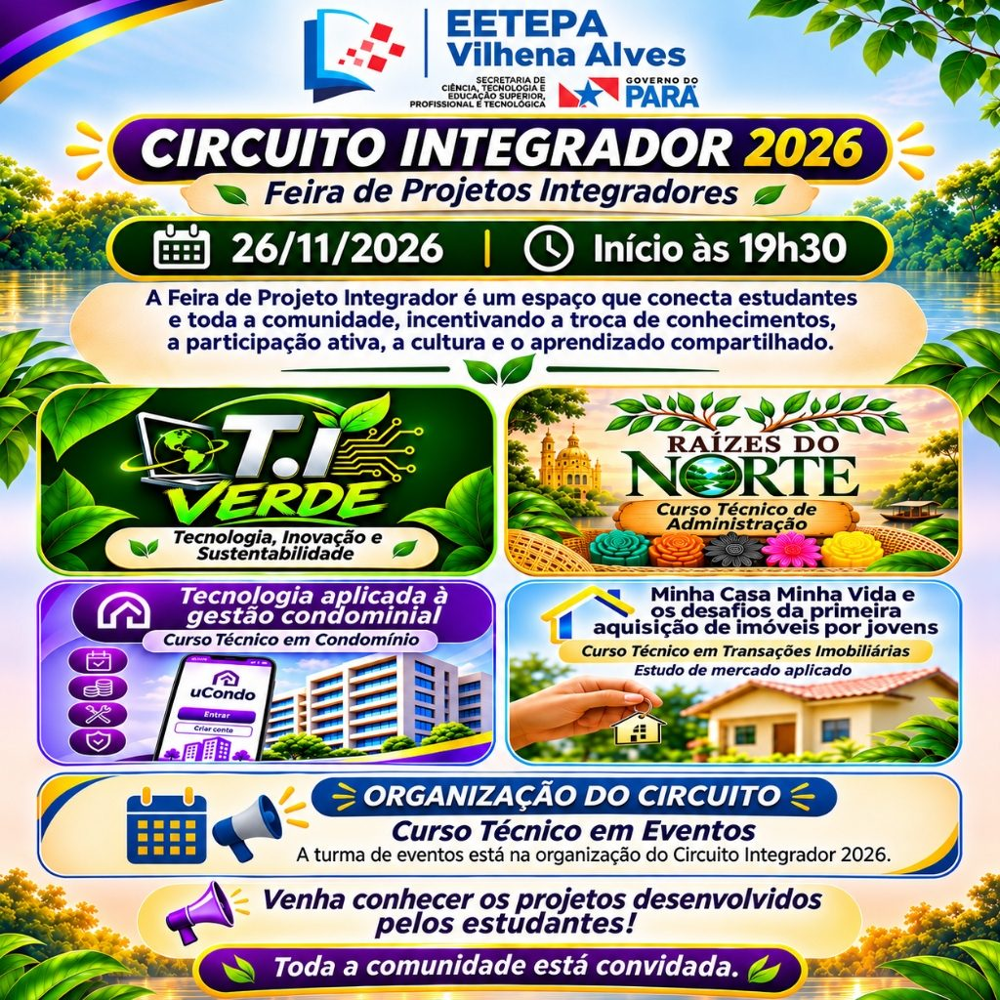

# T.I Verde — Tecnologia, Inovação e Sustentabilidade

Projeto educativo e interativo desenvolvido pela **turma P2 de Informática Subsequente 2026 da EETEPA Vilhena Alves** (SECTET / Governo do Pará) para o **Circuito Integrador 2026 — Feira de Projetos Integradores** (**26/11/2026, início às 19h30**).

🔗 **Acesse a página publicada (GitHub Pages):** [albertomateus9.github.io/TI_Verde](https://albertomateus9.github.io/TI_Verde/)

<p align="center">
  
</p>

---

## O que há na página

Construída em **HTML, CSS e JavaScript nativos** (sem build, sem frameworks pesados e seguindo os princípios do próprio *Green Coding*), a página funciona tanto para leitura em celulares quanto como apresentação interativa em monitor durante mostras científicas:

1. **Abertura comparativa** — Compara uma estação de trabalho típica antes e depois das práticas de TI Verde e exibe o panorama global de reciclagem formal (22,3%).
2. **Panorama em dados reais** — Quatro visualizações animadas (evolução do e-lixo global, waffle de reciclagem formal no Brasil, consumo elétrico global de data centers e ciclo de vida de um notebook) + **visualizador proporcional interativo de 200 dispositivos** em Canvas 2D.
3. **Simulador do laboratório de informática** — Permite ajustar o número de computadores (10 a 50), horas ociosas e ações práticas (suspensão automática, desligamento de réguas, upgrade de SSD + RAM, Mini-PCs/Thin Clients e redução de impressões) com cálculo transparente de kWh, R$, kg de CO₂e e máquinas preservadas.
4. **Engenharia da TI Verde** — Raio-X interativo do indicador **PUE** (*Power Usage Effectiveness*) e quatro frentes técnicas em abas acessíveis: *Hardware & Ciclo de Vida*, *Virtualização* (com demonstração de consolidação de 6 servidores físicos em 1 host), *Green Coding* e *Energia & Clima*.
5. **Legislação e Logística Reversa** — Síntese da **PNRS (Lei nº 12.305/2010)**, do **Decreto nº 10.240/2020** e links diretos para os localizadores oficiais de Pontos de Entrega Voluntária (PEVs) da **Green Eletron** e da **ABREE**.
6. **Triagem do e-lixo** — Mini-jogo interativo com 6 itens do cotidiano de TI para classificar entre *Reutilizar / Doar*, *Manutenção / Upgrade* e *Logística Reversa (PEV)*.
7. **Como agir hoje** — Guia prático dividido por perfil (*Estudante*, *Laboratório / Escola* e *Futuro Técnico em TI*).
8. **Desafio relâmpago + Gamificação local** — Oito perguntas cronometradas (atalhos de teclado `1`, `2`, `3`), XP, 10 conquistas, efeitos sonoros opcionais (`♪`, desligados por padrão) e placar local com botão **Novo visitante**.

---

## Modo apresentação e acessibilidade

- **Modo apresentação:** tecle `P` (ou clique em **Apresentar**) para tela cheia e navegue entre os capítulos com `←` `→`, `PageUp` / `PageDown` ou `↑` `↓`. Pressione `Esc` para sair.
- **Acessibilidade (WCAG 2.2 AA):** barra superior com ajuste de fonte (`A−` / `A+`), modo **Alto contraste**, link para pular ao conteúdo, navegação completa por teclado em abas e diálogos, suporte a `prefers-reduced-motion` e conteúdo legível mesmo sem JavaScript.
- **Privacidade:** progresso, preferências de leitura e placar ficam apenas no `localStorage` do navegador local; nenhum dado pessoal é enviado a terceiros.

---

## Como executar localmente

Não é necessário instalar dependências. Basta abrir `index.html` no navegador ou iniciar um servidor estático na raiz do repositório:

```bash
python -m http.server 8000
```

Depois acesse `http://localhost:8000/`.

---

## Fontes de dados e referências

- **ITU / UNITAR — Global E-waste Monitor 2024:** 62 milhões de toneladas globais em 2022 (+82% desde 2010), 22,3% de reciclagem formal documentada no mundo, projeção de 82 Mt para 2030 e ~2,4 Mt geradas no Brasil (~3% de reciclagem formal). [ewastemonitor.info](https://ewastemonitor.info/the-global-e-waste-monitor-2024/)
- **IEA — Electricity 2024 & Energy and AI (2025):** consumo elétrico global de data centers (~340 TWh em 2022, ~415 TWh em 2024, projeção cenário-base de ~945 TWh até 2030). [iea.org/reports/energy-and-ai](https://www.iea.org/reports/energy-and-ai)
- **Uptime Institute — Global Data Center Survey 2024:** média global de PUE em 1,56. [uptimeinstitute.com](https://uptimeinstitute.com/resources/research-and-reports)
- **ADEME & Fraunhofer IZM:** estudos de Avaliação de Ciclo de Vida (ACV) indicando que ~70% a 80% da pegada de carbono de notebooks ocorre na fase de fabricação.
- **Legislação brasileira e PEVs:** [Lei nº 12.305/2010 (PNRS)](https://www.planalto.gov.br/ccivil_03/_ato2007-2010/2010/lei/l12305.htm), [Decreto nº 10.240/2020](https://www.planalto.gov.br/ccivil_03/_ato2019-2022/2020/decreto/d10240.htm), [Green Eletron](https://greeneletron.org.br/localizador) e [ABREE](https://abree.org.br/pontos-de-recebimento).

---

> Desenvolvido pela **turma P2 de Informática Subsequente — EETEPA Vilhena Alves**.
